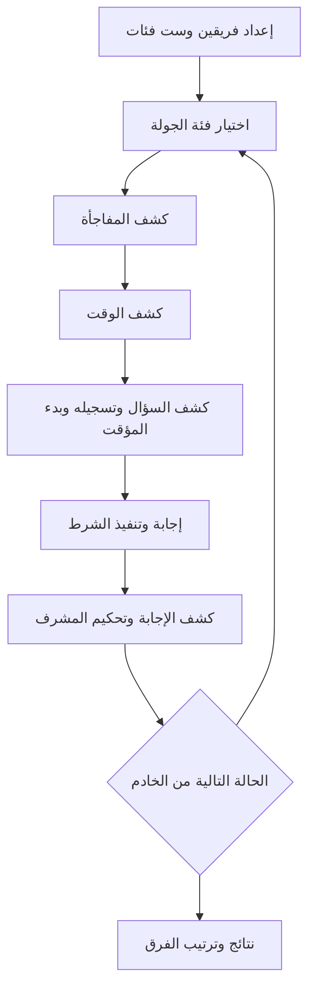

# تحليل لعبة 3 كروت: السلوك والمحتوى والبنية التقنية

تاريخ الفحص: 12 أكتوبر 2026. اللعبة المقصودة في هذا البحث هي **3 Krooot / ٣ كروت** المرتبطة بالنطاق https://www.3krooot.com/ ومعرّف أندرويد `com.krooot.app`.

هذا تحليل مبني على مشاهدة الموقع، وفحص نسخة JavaScript التي يرسلها الموقع للمتصفح، وقراءة واجهتي الفئات والأسعار العامتين، ومراجعة معلومات المتاجر الرسمية. **لم تُجرَّب مباراة كاملة داخل تطبيق الهاتف**، ولم يتوفر كود الخادم أو قاعدة الأسئلة. لذلك يوثق التقرير ما يمكن إثباته، ويحدد بدقة ما لم يُحسم، ولا يدّعي الوصول إلى كل تفاصيل النسخة الحالية.

## 1. الفكرة التي تقوم عليها اللعبة

اللعبة مسابقة اجتماعية بين فريقين، تجمع المعرفة مع ضغط الوقت وتغيير شروط الجولة. وحدة اللعب ليست السؤال وحده، وإنما اجتماع ثلاثة عناصر:

| العنصر | وظيفته | ما ثبت |
|---|---|---|
| السؤال | يحدد المطلوب والمكافأة الأساسية | سهل 200، متوسط 400، صعب 600 نقطة بحسب الوصف الرسمي |
| الوقت | يحدد مهلة الإجابة | الموقع يقول 15–60 ثانية؛ وصف تحديث أندرويد يقول 10–60، ولذلك الحد الأدنى مختلف بين المصادر |
| المفاجأة / التويست | تفرض طريقة إجابة أو تغير أثر الجولة | نص تعليمات، ومعه أحياناً أثر رقمي أو إجراء خاص |

العشوائية جزء أساسي من الفكرة المعلنة، لكن احتمالات اختيار السؤال والوقت والمفاجأة تقع في الخادم ولم يمكن قياسها. كذلك لا يظهر في واجهة الويب المفحوصة اختيار مستقل لمستوى الصعوبة؛ الإجراء الظاهر هو اختيار **فئة السؤال**. لا يصح تحويل وصف مستويات الأسئلة إلى ادعاء أن اللاعب يختار المستوى بنفسه.

## 2. كيف تبدأ الجلسة

تظهر في الملفات العامة مسارات لتسجيل الدخول، واختيار وضع اللعب، وإعداد الفرق والفئات، واللعب، والنتيجة، وشراء المحتوى واستعادة المشتريات. سياسة الخصوصية تصف تسجيل الدخول بواسطة Google وApple، وربط المشتريات والتقدم بالحساب.

### اللعب المحلي

1. اختيار اللعب المحلي.
2. اختيار العرض على الهاتف نفسه، أو ربط شاشة متصفح خارجية.
3. إنشاء فريقين وإدخال اسميهما. واجهة الإعداد تمنع إضافة فريق ثالث، وتمنع البداية بأقل من فريقين.
4. اختيار **ست فئات بالضبط**. يمنع العميل اختيار السابعة أو بدء الجلسة بعدد مختلف.
5. إرسال الفرق والفئات ومعرّف المستخدم إلى خدمة اللعبة.
6. الانتقال إلى اختيار فئة الجولة.

يوجد لكل فريق مظهر بصري، ويتضمن التطبيق صور شخصيات بألوان متعددة. لا توجد أدلة تثبت أن اللون يمنح أي ميزة داخل اللعب.

### ربط شاشة خارجية

الهاتف يطلب رمز ربط من الخادم. يفتح اللاعب الموقع على التلفاز أو اللابتوب ويدخل الرمز؛ بعد نجاح الربط تصل أحداث الاتصال وبدء الجلسة وتحديث حالتها. توجد أيضاً إجراءات لقطع ارتباط الشاشة وإنهاء جلستها.

هذه آلية مزامنة بين جهازين عبر الخدمة، وليست مجرد مشاركة فيديو لشاشة الهاتف. يظهر في الكود التعامل مع انقطاع الهاتف المضيف وإجبار شاشة العرض على العودة.

**قيد المشاهدة الحالية:** فتح الموقع دون جلسة مرتبطة عرض صفحة تعريف وتنزيل وفئات. رابط صفحة الروابط الموسوم للعب بالمتصفح أعاد إلى هذا الموقع نفسه. لم تظهر جلسة لعب جاهزة دون الهاتف.

### اللعب أونلاين

1. المضيف يدخل اسمه وينشئ غرفة.
2. الخادم يعيد كود الغرفة.
3. الآخرون يدخلون الكود وأسماءهم وينضمون.
4. تظهر غرفة انتظار فيها المضيف واللاعبون والفرق.
5. المضيف ينشئ الفريقين ويُوزّع اللاعبين بالسحب إلى الفرق.
6. المضيف يختار ست فئات، وتُزامن اختياراته مع بقية المشاركين.
7. يبدأ المضيف المباراة، وتنتقل الأجهزة إلى حالة اللعب المشتركة.

الحد الأعلى للاعبين داخل الغرفة، ومدة صلاحية كودها، وشروط إعادة دخول اللاعب الذي غادر، لم تُحسم من المواد المتاحة. وجود فريقين لا يعني وجود لاعبين فقط؛ تظهر واجهة منفصلة لأعضاء الفرق واللاعبين غير الموزعين.

## 3. دورة الجولة الفعلية في العميل

الترتيب التالي مثبت من شروط تفعيل الكروت ومن الأحداث التي يرسلها العميل:

1. تظهر الفئات الست، والدور الحالي، وعدد الأسئلة المتاحة لكل فئة.
2. يختار المشرف الفئة. يظهر تأثير وميض قبل إرسال الاختيار للخادم.
3. تصل بيانات السؤال والوقت والمفاجأة وحالة الجولة.
4. **يكشف المشرف كرت المفاجأة أولاً.**
5. بعده يتاح كشف كرت الوقت.
6. بعد كشف الوقت يتاح كشف كرت السؤال.
7. عند كشف السؤال يُرسل حدث حفظه ضمن الأسئلة المشاهَدة، ثم حدث بدء المؤقت؛ لا يبدأ العد بمجرد دخول شاشة الكروت.
8. ينفذ اللاعبون شرط المفاجأة ويجيبون ضمن الوقت.
9. يكشف المشرف الإجابة. يفتح حوار تحكيم لاختيار الفريق الذي أجاب أو الإشارة إلى عدم وجود إجابة صحيحة.
10. يرسل العميل نتيجة التحكيم للخادم، وتصل الحالة الجديدة؛ تتكرر الجولة أو تظهر النهاية وفق قرار الخدمة.



هذه لعبة تعتمد على التحكيم البشري في المسار المفحوص: لا تظهر فيه آلية إدخال جواب نصي وتصحيحه آلياً. يوجد حدث لإسناد الإجابة الصحيحة لفريق، وحدث لعدم الإجابة، ويملك المشرف أدوات لتغيير الفريق صاحب الدور وتعديل النقاط. لا يمكن من ذلك وحده إثبات قواعد انتقال حق الإجابة للفريق الآخر.

## 4. النقاط والمفاجآت

يستقبل العميل من الخدمة حقلي `pointsValue` و`penaltyValue` ويعرضهما. معنى ذلك أن قيمة المكافأة والعقوبة الفعلية تأتيان من الخادم، وأن قاعدة 200/400/600 وحدها لا تكفي لإعادة بناء الحسابات.

| النوع الظاهر | الدليل | السلوك الذي يمكن إثباته | ما يحتاج اختباراً |
|---|---|---|---|
| شرط إجابة نصي | بيانات `text` و`effect` | يعرض تعليمات إلزامية؛ الوصف الرسمي يعطي أمثلة تخص منع حرف أو عكس الإجابة | جميع الشروط، واستثناءاتها، وكيف يُحكم مخالفتها |
| `double_or_nothing` | فرع مباشر في العميل | يظهر قرار قبول الرهان أو رفضه؛ زر القبول يعرض معامل ×2 | مقدار الخصم عند الفشل، وأثر الرفض |
| `all_in_bet` | فرع مباشر في العميل والوصف الرسمي | يستعمل واجهة قرار الرهان نفسها | هل يشمل كامل الرصيد فعلاً، وكيف يعالج الرصيد الصفري أو السالب |
| `coin_multiplier` | فرع مباشر ونتيجة عملة | نتيجة «صورة» تعرض ×2، والنتيجة الأخرى ×0.5 | توقيت تطبيق المعامل، والتقريب، وأثره على العقوبة |
| `coin_decides_fate` | فرع مباشر ونتيجة عملة | «صورة» تعرض نتيجة صحيحة، والجهة الأخرى خاطئة، مع تخصيص لصاحب الدور | شروط استخدامه، وأثره الدقيق على النقاط وحق الفريق الآخر |
| عجلة الحظ | سجل تحديث iOS | موجودة في إصدار أحدث وتؤثر مباشرة في النقاط بحسب التحديث | قطاعات العجلة واحتمالاتها وقيمها؛ لم يظهر فرعها في ملف الويب المفحوص |
| رهان مخصص | سجل تحديث iOS | أضيف في تحديث 1.2.1، ويرتبط بالمراهنة بالنقاط ضد الخصم | المدخلات والحدود والمعادلة؛ غير مثبتة في نسخة العميل المفحوصة |

قرار الرهان وإجراء رمي العملة متاحان للمشرف في هذا العميل؛ بقية الأجهزة تنتظر القرار أو النتيجة. يرسل العميل طلب إجراء المفاجأة، وتصل النتيجة عبر حدث مستقل. وجود حركة رمي عملة لا يثبت أن نتيجتها تُختار عشوائياً على الجهاز؛ مسار النتيجة هنا يأتي من الخدمة.

لا يوجد ما يثبت ارتباط رهانات الجولة بمال حقيقي؛ المصادر تصف نقاط المباراة. ولا توجد قاعدة مثبتة حالياً تسمح بافتراض عقوبة موحدة لكل إجابة خاطئة.

## 5. المحتوى: جرد قابل للتحقق

في استجابة خدمة الفئات العامة وقت الفحص:

- **158 فئة** موزعة على **17 مجموعة**.
- **7 فئات موسومة مجانية** و**151 موسومة مدفوعة**.
- مجموع قيم `total` هو **18,524**، ومنها **1,400** في الفئات المجانية.

هذا مجموع العدادات التي تعلنها الخدمة، وليس تدقيقاً لكل نص سؤال، ولا إثباتاً أن جميع الأسئلة فريدة أو مكتملة أو متاحة لكل مستخدم. لم تُنزَّل قاعدة الأسئلة كاملة.

| الفئة المجانية | العدد المعلن |
|---|---:|
| رياضة | 232 |
| معلومات عامة | 239 |
| دين | 243 |
| عالم الحيوان | 120 |
| جغرافيا | 210 |
| علوم | 239 |
| بنات و بس | 117 |

تجمع المكتبة معرفة عامة، ورياضة، وديناً، وجغرافيا، وتاريخاً، وعلوماً، وأدباً، وأفلاماً ومسلسلات وأنمي وسبيستون وطرباً وألعاب فيديو ودولاً وفئات تخمين. وتحتوي أيضاً عناوين تصف مهام مختلفة، مثل الرسم والمزاد وترتيب الأحداث والحروف المبعثرة والترجمة. **عنوان الفئة لا يكفي لإثبات وجود ميكانيكية خاصة بها**؛ لم يُجرَّب سؤال من كل عنوان لتحديد هل هو مجرد محتوى أم مسار لعب مختلف.

يحفظ ملف `research/categories.csv` جميع العناوين والمجموعات والأعداد والحالة التجارية. وتوجد القائمة كاملة في آخر التقرير.

## 6. منع تكرار الأسئلة والتقدم

تعيد خدمة الفئات حقولاً منها: `total`، و`played`، و`remaining`، و`percent`، و`remainingPercent`، و`isCompleted`. يعرض العميل التقدم والأسئلة المتبقية، ويعطل اختيار فئة عند نفاد العدد في شاشة الجولة.

تُرسل هوية السؤال وفئته ومجموعته إلى حدث `mark_question_seen` عند الكشف، قبل التحكيم. لذلك السلوك المثبت هو تسجيل **المشاهدة**، وليس الاقتصار على تسجيل الأسئلة الصحيحة. وتصف سياسة الخصوصية حفظ التقدم لتقليل تكرار الأسئلة وربطه بالمستخدم.

لم يُحسم: هل تُحتسب المشاهدة على المضيف وحده أم جميع الأعضاء، وهل توجد إعادة ضبط رسمية للبنك بعد استهلاكه، وكيف يتعامل الخادم مع سؤال شوهد ثم انقطعت الجلسة.

## 7. خريطة الشاشات والمكونات

| الشاشة | المكونات والأفعال الظاهرة في الملفات |
|---|---|
| الصفحة التعريفية | شعار، فكرة اللعبة، تنزيل التطبيق، فئات، روابط اجتماعية، حقوق النشر |
| اختيار الوضع | محلي وأونلاين، معلومات الحساب، تسجيل خروج، حذف حساب |
| اختيار شاشة العرض | هاتف واحد أو متصفح على شاشة خارجية |
| ربط المتصفح | رمز ربط، انتظار اتصال، نجاح أو خطأ، قطع الارتباط |
| إعداد المحلي | إضافة وحذف فريق، اسم ومظهر، اختيار ست فئات، بدء |
| إعداد الأونلاين | اسم اللاعب، إنشاء غرفة، دخول بالكود |
| غرفة الانتظار | الكود، المضيف، لاعبو الفرق وغير الموزعين، سحب للتوزيع، اختيار فئات، بدء |
| اختيار فئة الجولة | صور الفئات، عدد الأسئلة، الفئة المنتهية، اسم صاحب الدور |
| الكروت | سؤال ووقت ومفاجأة، كشف متتابع، مكافأة وعقوبة، أدوات مرتبطة بالتويست |
| الإجابة والتحكيم | الإجابة الصحيحة، اختيار الفريق أو عدم إجابة |
| نهاية المباراة | بطل وترتيب الفرق، إعادة اللعب، العودة للرئيسية |
| الشراء | مزايا النسخة الكاملة، عرض وسعر، شراء، استعادة، تأكيد التفعيل |

المظهر الذي شوهد يتجه إلى العربية، ويستعمل خلفية صفراء فاتحة، ووردي وأزرق للكروت، وبطاقات مستديرة، وظلالاً، وشعار ثلاثة كروت. يظهر خط `FFHekaya` في الكود. توجد رسوم للشعار، وحركات لقلب الكروت ووميض الاختيار ورمي العملة، ومعالجة للمقاسات المختلفة. صور المتجر تؤكد وجود المحلي والأونلاين، لكنها مواد دعائية ولا تثبت وحدها تفاصيل مباراة حية.

## 8. البنية التقنية المثبتة

| الطبقة | ما ثبت | حدود الاستنتاج |
|---|---|---|
| عميل الويب | Flutter Web، تحويل Dart إلى JavaScript، رسم CanvasKit | لا يثبت تطابق كل إصدار هاتف مع هذا العميل |
| خدمة التطبيق | `https://api.3krooot.com` | تقنية الخادم وقاعدة البيانات غير معروفتين |
| تحديثات المباراة | Socket.IO باستعمال WebSocket في تهيئة العميل | لا توجد جلسة اختبار لقياس التأخير أو تحمل الانقطاع |
| بيانات الفئات والأسعار | طلبات HTTP لواجهات عامة | لا تمثل قاعدة الأسئلة أو قواعد الحساب كاملة |
| الصوت | WebRTC، وتبادل offer/answer/ICE عبر أحداث الخدمة، إعدادات STUN وTURN | لم يُختبر الصوت ولا يُثبت ذلك تدقيقاً أمنياً للخدمة |
| الدخول | مكونات Google Sign-In في العميل؛ سياسة الخدمة تذكر Apple أيضاً | مسار تحقق الخادم من الهوية غير متاح |
| المشتريات | مكونات RevenueCat وشراء واستعادة وربط امتياز بالحساب | آلية تحقق الخادم من إيصالات المتجر غير متاحة |
| التخزين المحلي | مفاتيح منها `saved_userId` و`saved_username` | ليست دليلاً على أن جميع بيانات التقدم مخزنة محلياً |

الاستنتاج المعماري الأقوى هو أن العميل يرسل أفعالاً، والخدمة تنشر حالة مشتركة تشمل المرحلة والنقاط والفرق والكروت والمؤقت. **لا يثبت فحص العميل وحده** أن الخادم يتحقق من صلاحيات كل فعل أو يفرض جميع القواعد؛ ذلك يحتاج كود الخادم أو اختبار جلسة مصرح بها.

## 9. نموذج البيانات المستنتج من العميل

هذه حقول يتعامل معها الكود، وليست مخطط قاعدة بيانات مؤكداً:

```text
Category:
  title, collection, url, version, status,
  total, played, remaining, percent, remainingPercent, isCompleted

Question:
  id, text, category, collection, level, correctAnswer, imageUrl

Twist:
  text, type, effect, value

GameState:
  version, phase, question, twist, timer,
  isTwistRevealed, isTimerRevealed, isQuestionRevealed,
  betStatus, pointsValue, penaltyValue,
  activePlayer, currentRound, totalRounds, teams, categoryStats
```

قيم المراحل الظاهرة تشمل `CATEGORY_SELECT` و`QUESTION_PHASE` و`TWIST_PHASE` و`GAME_OVER`، مع حالة تحميل محلية. يستقبل العميل عدد الجولة وعدد الجولات الكلي؛ **لم يُثبت عدد ثابت لجولات المباراة**. رغم تسمية `activePlayer`، تقارن الواجهة هذه القيمة باسم فريق وتوجد أداة لاختيار الفريق صاحب الدور.

## 10. بروتوكول الأحداث الظاهر

| الوظيفة | أحداث من العميل | أحداث إلى العميل |
|---|---|---|
| المحلي | `create_local_game` | `local_game_started` |
| الغرف | `create_online_game`, `join_online_game`, `start_online_game` | `online_room_created`, `online_room_joined`, `online_game_started`, `join_error` |
| الفرق والفئات | `update_lobby_teams`, `sync_lobby_categories` | `lobby_updated`, `lobby_categories_updated` |
| شاشة خارجية | `request_browser_pairing`, `browser_join_session`, `kill_browser_session` | `pairing_code_generated`, `browser_connected`, `pairing_error` |
| الجولة | `select_category`, `supervisor_flip_card`, `start_timer_signal`, `mark_question_seen` | `update_game_state`, `timer_tick` |
| التحكيم | `supervisor_reveal_answer`, `supervisor_assign_correct`, `supervisor_no_answer` | `show_answer_dialog`, `update_game_state` |
| أدوات المشرف | `set_active_player`, `adjust_local_score` | تحديث الحالة |
| المفاجآت | `submit_bet_decision`, `request_twist_action` | `coin_flip_started`, `twist_action_result` |
| الاتصال والنهاية | `rejoin_game`, `leave_game`, `end_game` | `player_joined`, `player_left`, `phone_disconnected`, `force_disconnect`, `error_game_not_found` |
| الصوت | `webrtc_join_voice`, `webrtc_offer`, `webrtc_answer`, `webrtc_ice_candidate` | إشارات الصوت والأقران |

أمثلة حقول فعلية في الرسائل: كشف كرت يحمل `cardType` بقيم `twist` أو `timer` أو `question`؛ تحكيم الصحيح يحمل `teamId`؛ تعديل الرصيد يحمل `teamId` و`delta`؛ قرار الرهان يحمل `decision`؛ ربط الشاشة يحمل `code`؛ تسجيل السؤال يحمل `questionId` و`category` و`collectionName`.

هذه قائمة مستخرجة بالملاحظة الساكنة للعميل. لم تُرسل أوامر لهذه الأحداث بغرض إنشاء جلسات أو تغيير حسابات أثناء البحث.

## 11. نموذج الإتاحة والشراء

الحالة المجانية والمدفوعة معلنة لكل فئة في الخدمة. يتعامل العميل أيضاً مع امتياز `isPremium`؛ الفئات المدفوعة تعرض قفلاً أو توجيهاً للشراء عندما لا يكون الامتياز متاحاً.

في استجابة التسعير العامة توجد باقة مدى حياة مفعلة بمعرف `full_version_id` وسعر حزمة `4.99`، بينما السعر العام الأعلى في الاستجابة `9.99` والعملة `$`. **هذه قيم متعارضة داخل إعداد التسعير، ولا تمثل تأكيداً للسعر النهائي في متجر المستخدم**. متجر iOS يعرض كذلك مشتريات لمدة أسبوع و30 يوماً، وسجله يصف تقديم باقات مؤقتة. يحتمل وجود إعدادات أو منتجات قديمة؛ لا يمكن حسم المتاح لكل منصة من هذه البيانات وحدها.

توجد مسارات لاستعادة المشتريات، والنجاح، وعدم العثور على شراء، وأخطاء الدفع. وتعرض واجهة النسخة الكاملة فتح الفئات والمفاجآت وإزالة الإعلانات. الإعلان عن هذه المزايا لا يثبت أن النسخة المجانية تعرض إعلاناً في كل مباراة.

## 12. الحالات الخاصة والمخاطر الوظيفية

العميل يعالج: رمز ربط غير صحيح، فشل انضمام، فقد جلسة، انقطاع الهاتف المضيف، إنهاء من المضيف، فشل تشغيل الميكروفون، إعادة اتصال بالخدمة، وعدم وجود فئات. توجد آلية مراقبة لاتصالات الصوت ومحاولة إعادة بنائها، وصناديق انتظار لإشارات ICE التي تصل قبل جاهزية الاتصال.

أكثر الحالات تأثيراً عند بناء تطبيق مشابه: ضغط زر الكشف مرتين، وصول حدث قديم بعد الانتقال للجولة التالية، العد المتأخر بين الأجهزة، مغادرة المضيف، تسجيل سؤال دون إكمال الجولة، قبول رهان برصيد صفر، وأصوات عدة أجهزة في مكان واحد. هذه **حالات تحقق مقترحة** وليست أعطالاً ثبت حدوثها في اللعبة.

## 13. ما يلزم لحسم الفهم الكامل

| المسألة غير المحسومة | التجربة التي تحسمها |
|---|---|
| كامل مجموعة التويستات واحتمالاتها | معاينة القائمة المتاحة أو تسجيل جولات عديدة مع إصدار التطبيق |
| صحة وخطأ وانتهاء الوقت | جولات مضبوطة بنتائج مختلفة ومقارنة الرصيد قبل وبعد |
| كل نوع رهان | قبول ورفض وفوز وخسارة بأرصدة معروفة |
| العملة والعجلة | مقارنة النتيجة والرصيد والتوقيت وأثرها على الفريقين |
| عدد الجولات وشرط النهاية | مباراة كاملة حتى النهاية، ثم تجربة إعادة اللعب |
| التعادل | مباراة تنتهي بفريقين متساويين |
| توزيع الدور وانتقال حق الإجابة | جولات متتابعة تشمل إجابة الخصم وعدم وجود جواب |
| حساب مشاهدة الأسئلة | مستخدمان معروفان يشاهدان الجلسة نفسها ثم مقارنة تقدمهما |
| الأونلاين | هاتفان/حسابان وغرفة خاصة، مع تجربة الانقطاع وإعادة الدخول |
| الفئات التي تشبه مهام خاصة | تجربة سؤال فعلي من الرسم والمزاد والتخمين وغيرها |
| مشتريات وتجربة مجانية | معاينة شاشة عروض الحساب والمنصة الحالية دون الحاجة لشراء أثناء البحث |

المتاح حالياً يكفي لإعداد مواصفات أولية قوية للواجهات وتدفق الجلسة والتزامن، لكنه لا يكفي لادعاء نسخة مطابقة في كل حسابات النقاط وكل محتوى اللعبة. للوصول إلى ذلك يلزم الوصول الطبيعي إلى التطبيق أو جلسة لعب يفتحها المستخدم.

## 14. ملفات الأدلة والمصادر

- `research/homepage.html`: HTML العام للموقع.
- `research/flutter_bootstrap.js`: إعداد تحميل Flutter، يتضمن مسار العميل ونوع البناء.
- `research/main.dart.js`: نسخة العميل المنشورة وقت الفحص.
- `research/main.decoded.js`: النسخة نفسها بعد تحويل محارف Unicode لتسهيل قراءة العربية؛ ليست كود Dart الأصلي.
- `research/game-code.js`: مقتطف مركز من العميل للقراءة والتحليل.
- `research/ui-arabic-strings.txt`: نصوص واجهة مستخرجة، وتشمل أيضاً رسائل تشخيص.
- `research/category-images.json`: استجابة فهرس الفئات العام.
- `research/categories.csv`: جرد الفئات مع أعدادها وحالتها.
- `research/premium-price.json`: استجابة إعدادات السعر العام.

المراجع الخارجية: [الموقع الرسمي](https://www.3krooot.com/)، [فهرس الفئات العام](https://api.3krooot.com/api/images)، [Google Play](https://play.google.com/store/apps/details?id=com.krooot.app)، [App Store وسجل الإصدارات](https://apps.apple.com/us/app/3-krooot-%D9%A3-%D9%83%D8%B1%D9%88%D8%AA/id6759845290)، [سياسة الخصوصية](https://www.3krooot.com/privacy-policy/).

البيانات والعميل المنشوران قابلان للتحديث. بعض أوصاف المتاجر تختلف عن الموقع وبعض ميزات إصدار الهاتف أحدث من فروع الويب التي فُحصت؛ يجب حفظ هذا التمييز عند استعمال التقرير كمواصفات تطوير.

## 15. الجرد الكامل للفئات

الأرقام والحالة أدناه من استجابة الخدمة في تاريخ الفحص. ترتيب العرض مجموع بحسب مكتبة المحتوى لتسهيل القراءة.

### Gaming

| الفئة | عدد الأسئلة المعلن | الإتاحة |
|---|---:|---|
| ألعاب الكترونيه | 100 | مدفوعة |
| Call of Duty | 121 | مدفوعة |

### أدب

| الفئة | عدد الأسئلة المعلن | الإتاحة |
|---|---:|---|
| بمعنى | 120 | مدفوعة |
| لغات و أدب | 108 | مدفوعة |
| من القائل | 128 | مدفوعة |
| شعر | 105 | مدفوعة |
| لغة عربية ونحو | 105 | مدفوعة |

### أفلام

| الفئة | عدد الأسئلة المعلن | الإتاحة |
|---|---:|---|
| أفلام | 114 | مدفوعة |
| Marvel | 48 | مدفوعة |
| Harry Potter | 119 | مدفوعة |
| Disney | 115 | مدفوعة |
| K-Pop Demon Hunters | 97 | مدفوعة |

### أنمي

| الفئة | عدد الأسئلة المعلن | الإتاحة |
|---|---:|---|
| أنمي | 112 | مدفوعة |
| ناروتو | 127 | مدفوعة |
| هجوم العمالقة | 116 | مدفوعة |
| One piece | 109 | مدفوعة |
| Bleach | 94 | مدفوعة |
| Demon slayer | 54 | مدفوعة |
| Death Note | 29 | مدفوعة |
| Hunter x Hunter | 39 | مدفوعة |
| دراغون بول | 40 | مدفوعة |
| Jujutsu Kaisen | 96 | مدفوعة |
| Chainsaw Man | 100 | مدفوعة |
| Steins;Gate | 102 | مدفوعة |

### بنات

| الفئة | عدد الأسئلة المعلن | الإتاحة |
|---|---:|---|
| بنات و بس | 117 | مجانية |
| دراما كورية | 94 | مدفوعة |

### تاريخ

| الفئة | عدد الأسئلة المعلن | الإتاحة |
|---|---:|---|
| تاريخ | 103 | مدفوعة |

### جغرافيا

| الفئة | عدد الأسئلة المعلن | الإتاحة |
|---|---:|---|
| جغرافيا | 210 | مجانية |
| أعلام | 119 | مدفوعة |
| عواصم | 133 | مدفوعة |
| ما هي الدولة؟ | 125 | مدفوعة |

### خمن

| الفئة | عدد الأسئلة المعلن | الإتاحة |
|---|---:|---|
| خمن الفيلم | 96 | مدفوعة |
| خمن المسلسل | 99 | مدفوعة |
| خمن الأنمي | 118 | مدفوعة |
| خمن المثل | 104 | مدفوعة |
| خمن الكرتون | 99 | مدفوعة |
| خمن اللاعب | 98 | مدفوعة |

### دول

| الفئة | عدد الأسئلة المعلن | الإتاحة |
|---|---:|---|
| السعودية | 72 | مدفوعة |
| الكويت | 74 | مدفوعة |
| قطر | 72 | مدفوعة |
| الأردن | 75 | مدفوعة |
| فلسطين | 70 | مدفوعة |
| العراق | 73 | مدفوعة |
| الجزائر | 74 | مدفوعة |
| سلطنة عمان | 73 | مدفوعة |
| مصر | 74 | مدفوعة |
| المغرب | 75 | مدفوعة |
| سوريا | 73 | مدفوعة |

### دين

| الفئة | عدد الأسئلة المعلن | الإتاحة |
|---|---:|---|
| دين | 243 | مجانية |
| قصص الأنبياء | 226 | مدفوعة |
| أكمل الآية | 112 | مدفوعة |
| أكمل الحديث | 118 | مدفوعة |
| السيرة النبوية | 126 | مدفوعة |
| ما هي السورة؟ | 216 | مدفوعة |
| جزء عم | 170 | مدفوعة |
| حروف إسلامي | 187 | مدفوعة |

### رياضة

| الفئة | عدد الأسئلة المعلن | الإتاحة |
|---|---:|---|
| رياضة | 232 | مجانية |
| انتقالات اللاعبين | 101 | مدفوعة |
| مسيرة لاعب | 114 | مدفوعة |
| من سجل الهدف | 94 | مدفوعة |
| NBA | 102 | مدفوعة |
| كأس العالم | 147 | مدفوعة |
| دوري أبطال أوروبا | 90 | مدفوعة |
| الدوري الاسباني | 92 | مدفوعة |
| الدوري الانجليزي | 98 | مدفوعة |
| تنس | 97 | مدفوعة |
| ريال مدريد | 97 | مدفوعة |
| برشلونة | 92 | مدفوعة |
| فانتازي البريمرليج | 70 | مدفوعة |
| Bodybuilding | 47 | مدفوعة |
| الدوري السعودي | 124 | مدفوعة |
| ليونيل ميسي | 116 | مدفوعة |
| كريستيانو رونالدو | 119 | مدفوعة |
| مصارعة | 100 | مدفوعة |
| UFC | 51 | مدفوعة |
| اسم اللاعب | 111 | مدفوعة |
| Formula 1 | 116 | مدفوعة |
| قصة لاعب | 169 | مدفوعة |
| حروف كروية | 217 | مدفوعة |
| ولا كلمة كروية | 200 | مدفوعة |
| النادي المشترك | 182 | مدفوعة |
| قصة نادي | 124 | مدفوعة |

### سبيستون

| الفئة | عدد الأسئلة المعلن | الإتاحة |
|---|---:|---|
| كرتون قديم | 125 | مدفوعة |
| المحقق كونان | 42 | مدفوعة |
| أبطال الديجيتال | 55 | مدفوعة |
| سبيستون | 100 | مدفوعة |
| شارات سبيستون | 90 | مدفوعة |

### طرب

| الفئة | عدد الأسئلة المعلن | الإتاحة |
|---|---:|---|
| طرب | 113 | مدفوعة |
| محمد عبده | 96 | مدفوعة |
| ام كلثوم | 94 | مدفوعة |

### علوم

| الفئة | عدد الأسئلة المعلن | الإتاحة |
|---|---:|---|
| علوم | 239 | مجانية |
| رياضيات | 103 | مدفوعة |
| طب | 108 | مدفوعة |
| تكنولوجيا المعلومات | 152 | مدفوعة |
| فيزياء | 109 | مدفوعة |
| كيمياء | 108 | مدفوعة |
| أحياء | 105 | مدفوعة |
| فضاء وفلك | 114 | مدفوعة |

### فئات عامة

| الفئة | عدد الأسئلة المعلن | الإتاحة |
|---|---:|---|
| معلومات عامة | 239 | مجانية |
| عالم الحيوان | 120 | مجانية |
| إكمال السلسلة | 116 | مدفوعة |
| حروف | 291 | مدفوعة |
| لهجات عربية | 117 | مدفوعة |
| قدرات عامة | 205 | مدفوعة |
| حكم و أمثال | 125 | مدفوعة |
| ألغاز | 80 | مدفوعة |
| ايش الرابط | 136 | مدفوعة |
| أكلات حول العالم | 137 | مدفوعة |
| سيارات | 159 | مدفوعة |
| ثقافات الشعوب | 139 | مدفوعة |
| من المشهور (عربي) | 147 | مدفوعة |
| من المشهور (أجنبي) | 164 | مدفوعة |
| من أنا؟ | 120 | مدفوعة |
| خرافات وأساطير الشعوب | 112 | مدفوعة |
| Gen Z | 111 | مدفوعة |
| لغز و جريمة | 88 | مدفوعة |
| خمن اللغة أو اللهجة | 101 | مدفوعة |
| قوانين غريبة | 88 | مدفوعة |
| الكلمة الدخيلة | 245 | مدفوعة |
| حروف مبعثرة | 220 | مدفوعة |
| رتب الأحداث | 138 | مدفوعة |
| ولا كلمة | 300 | مدفوعة |
| ترجم | 194 | مدفوعة |
| Falcons | 83 | مدفوعة |
| Powr | 119 | مدفوعة |
| المزاد | 120 | مدفوعة |
| رسم | 134 | مدفوعة |
| أول من؟ | 124 | مدفوعة |
| خمن الأكلة | 136 | مدفوعة |
| صح أم خطأ | 124 | مدفوعة |
| شطرنج | 123 | مدفوعة |
| حروف إنجليزي | 125 | مدفوعة |
| أكمل الفراغ | 177 | مدفوعة |

### فن عربي

| الفئة | عدد الأسئلة المعلن | الإتاحة |
|---|---:|---|
| باب الحارة | 116 | مدفوعة |
| فن عربي | 110 | مدفوعة |
| فن خليجي | 108 | مدفوعة |
| مسرحيات | 127 | مدفوعة |
| مسلسلات كويتية | 149 | مدفوعة |
| مسلسلات مصرية | 159 | مدفوعة |
| مسلسلات سورية | 62 | مدفوعة |
| أفلام مصرية | 120 | مدفوعة |

### مسلسلات

| الفئة | عدد الأسئلة المعلن | الإتاحة |
|---|---:|---|
| مسلسلات | 113 | مدفوعة |
| Game of thrones | 93 | مدفوعة |
| Breaking bad | 99 | مدفوعة |
| فن تركي | 100 | مدفوعة |
| Friends | 91 | مدفوعة |
| The Walking Dead | 101 | مدفوعة |
| Squid Game | 55 | مدفوعة |
| BoJack Horseman | 46 | مدفوعة |
| Rick and Morty | 46 | مدفوعة |
| Stranger Things | 98 | مدفوعة |
| Peaky Blinders | 98 | مدفوعة |
| The Sopranos | 95 | مدفوعة |
| Better Call Saul | 56 | مدفوعة |
| The Office | 116 | مدفوعة |
| Vikings | 114 | مدفوعة |
| Mr. Robot | 116 | مدفوعة |
| La Casa De Papel | 108 | مدفوعة |
